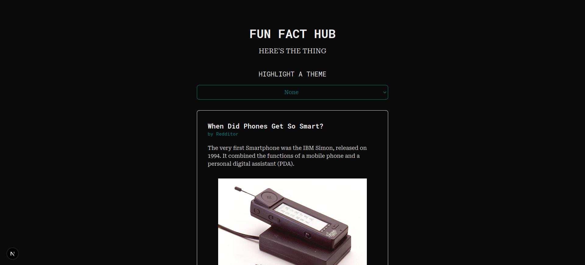
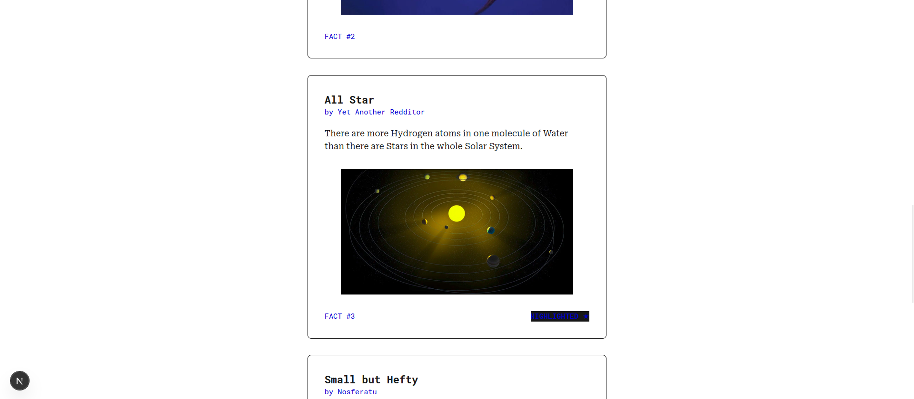

# FUN FACT HUB

## About

After doing the [Tic-Tac-Toe](https://react.dev/learn/tutorial-tic-tac-toe) example I kept deepening my understanding by reading through the rest of the [React Documentation](https://react.dev/learn/describing-the-ui). And to try out the concepts I learnt I decided to create a simple example website.


</img>

The concepts tested were the following:
- [Conditional Rendering](https://react.dev/learn/conditional-rendering)
- Using Javascript Maps to [Render Lists](https://react.dev/learn/rendering-lists)
- Understanding Function Arguments / Javascript Props and [Passing them to a Component](https://react.dev/learn/passing-props-to-a-component)
- Using [tailwindcss](https://tailwindcss.com/) for styling


</img>

## Usage

To install dependencies:

```bash
npm audit fix --force
```
```bash
npm run build
```
To run the devolpment branch:

```bash
npm run dev
```
