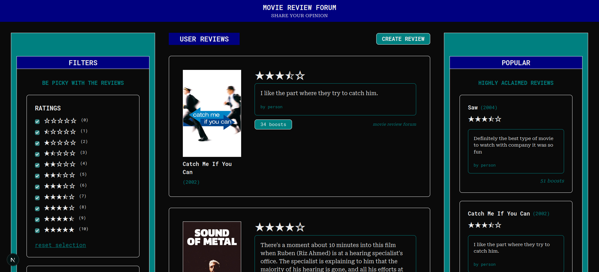
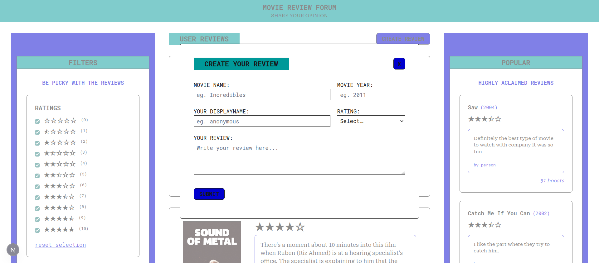

# MOVIE REVIEW FORUM

## About

Following the spirit of the previous project, [Fun Fact Hub](../fun-fact-hub/README.md), I decided to create a slighty more ambitious project that would explore everything until now but specially focus on the ways to add Interaction from [React Documentation - Adding Interactivity](https://react.dev/learn/adding-interactivity).


</img>

The concepts tested were the following:
- [Responding to Events](https://react.dev/learn/responding-to-events)
- [Queueing a Series of State Updates](https://react.dev/learn/queueing-a-series-of-state-updates)
- [Updating Objects in State](https://react.dev/learn/updating-objects-in-state)
- [Updating Arrays in State](https://react.dev/learn/updating-arrays-in-state)
- [JavaScript Math Reference](https://www.w3schools.com/jsref/jsref_obj_math.asp)
- [JavaScript Object Reference](https://www.w3schools.com/jsref/jsref_obj_object.asp)
- Interfaces - [TypeScript Object Types](https://www.geeksforgeeks.org/typescript/typescript-object-types/)
- [JavaScript Object Reference](https://www.w3schools.com/jsref/jsref_obj_object.asp)
- Using "keyof" - [How to Cast a String to keyof in TypeScript](https://www.webdevtutor.net/blog/typescript-cast-string-to-keyof)
- [Responsive design](https://tailwindcss.com/docs/responsive-design) with tailwindcss


</img>

The Forum starts with 5 reviews by default but the user can then add new reviews about their movie of choice. The user can "boost" reviews so they can become more popular and show up on the "POPULAR" side bar dedicated to the top 3 most boosted reviews. The shown reviews on the Feed can also be filtered based on the star Rating given, the number of Boosts the review has recieved and the movie's Release Year (the filtering doesn't affect the "POPULAR" side bar).

## Usage

To install dependencies:

```bash
npm audit fix --force
```
```bash
npm run build
```
To run the devolpment branch:

```bash
npm run dev
```
