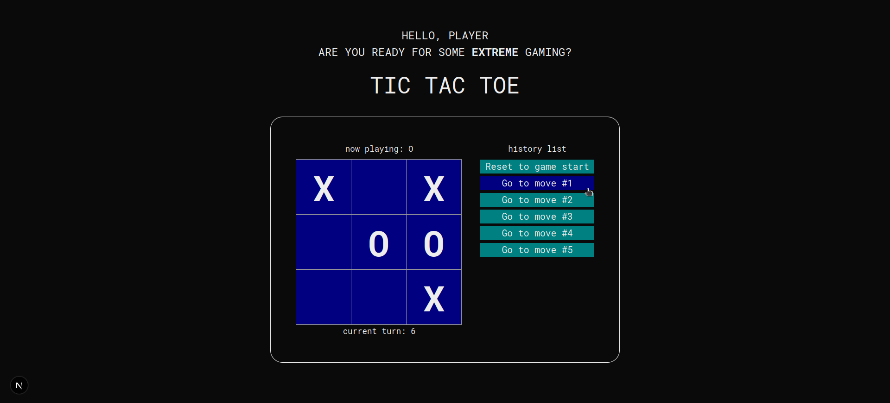
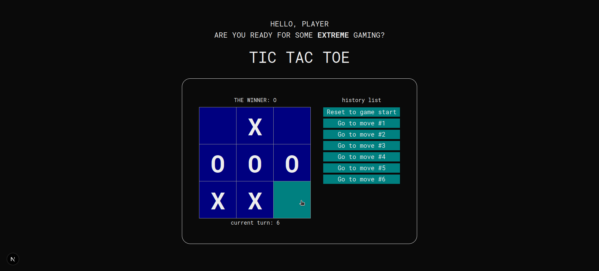

# TIC-TAC-TOE (first contact with React)

## About

Following the [Tutorial: Tic-Tac-Toe – React](https://react.dev/learn/tutorial-tic-tac-toe) I started learning about some basic functionalities of Typescript and React. Learning about React Components, Typescript Arrays, useState(), props and variable types.


</img>

The Tutorial follows a "learn by failing" structure that helped explore the logic behind it but also left a lot of questions unanswered that are later better explained in the [React Documentation](https://react.dev/learn/describing-the-ui).


</img>

## Usage

To install dependencies:

```bash
npm audit fix --force
```
```bash
npm run build
```
To run the devolpment branch:

```bash
npm run dev
```

## Resume of the Next.js deafult README.md

### Creating the Project and Running it
This is a [Next.js](https://nextjs.org) project bootstrapped with [`create-next-app`](https://nextjs.org/docs/app/api-reference/cli/create-next-app).

```bash
npx create-next-app@latest [project-name] [options]
```

To run the development server:

```bash
npm run dev
```

Open [http://localhost:3000](http://localhost:3000) with your browser to see the result.


### Editing and Working
You can start editing the page by modifying `app/page.tsx`. The page auto-updates as you edit the file.

This project uses [`next/font`](https://nextjs.org/docs/app/building-your-application/optimizing/fonts) to automatically optimize and load [Fonts](https://vercel.com/font).
