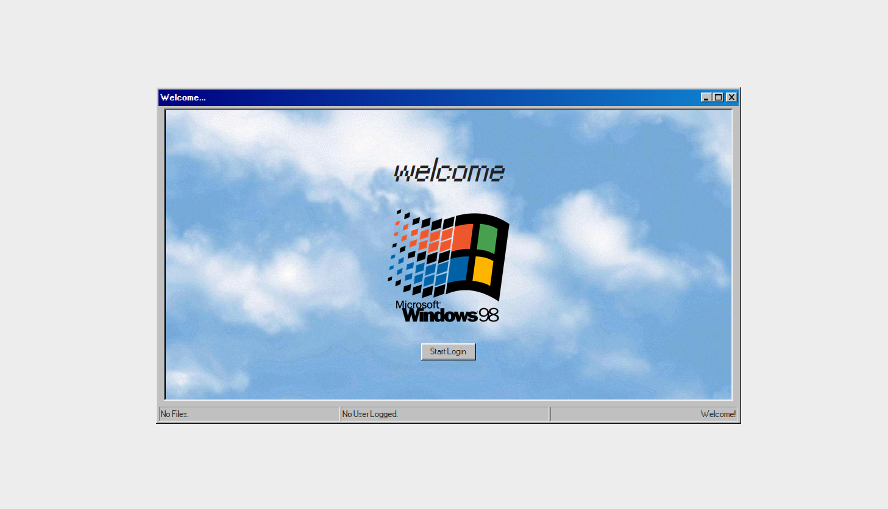
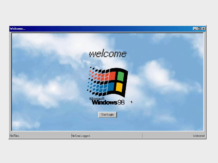
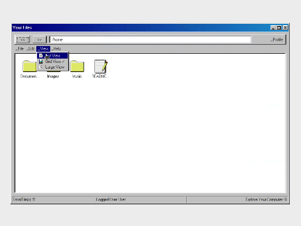
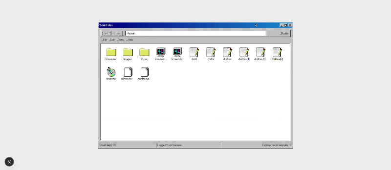

# YOUR FILES

## About

The <b>Your Files</b> project was created after the [Movie Review Forum](../movie-review-forum/README.md), which played heavily with user input, so for this time around the focus was on the user interaction with a fake "Computer". That came to mind as a way to experiment with what is taught in the [React Documentation - Managing State](https://react.dev/learn/managing-state).


</img>

The concepts tested were the following:

- [Union Types](https://www.typescriptlang.org/docs/handbook/2/everyday-types.html#union-types)
- State Machine to Determine the UI - [Reacting to Input with State](https://react.dev/learn/reacting-to-input-with-state)
- [Type Alias](https://www.typescriptlang.org/docs/handbook/2/everyday-types.html#type-aliases)
- [Conditional Element Styling](https://react.dev/learn/reacting-to-input-with-state#challenges)
- [Preserving and Resetting State](https://react.dev/learn/preserving-and-resetting-state)
- [useReducer](https://react.dev/learn/extracting-state-logic-into-a-reducer)
- [useContext](https://react.dev/learn/passing-data-deeply-with-context)
- [Normalizing a tree-like Structure](https://react.dev/learn/choosing-the-state-structure#avoid-deeply-nested-state)


</img>

There are 2 hard coded user profiles and corresponding File Systems. The credentials are the following:

| User   | Password |
| ------ | -------- |
| banana | ana123   |
| User   | Password |

The profiles can be viewed and navigated but not edited. There are options for changing the theme to "Light Mode" or "Dark Mode" and to change the file explorer view from "List View", "Grid View" and "Large View".


</img>

To go into a file or a folder it's possible to double click it or using the navigation arrows on the top left corner of the "file explorer" to get into, or out of, the first file present in the folder.

To change User there is an option to Log Out in the "_Profile" dropdown option.

And for extra fun there are some Pop ups and all the windows and draggable.


</img>

## Usage

To install dependencies:

```bash
npm audit fix --force
```

```bash
npm run build
```

To run the devolpment branch:

```bash
npm run dev
```

## Resources

### styling and tailwindcss:

- [98.css - A design system for building faithful recreations of old UIs](https://jdan.github.io/98.css/)
- [98.css CSS stylesheet](https://github.com/jdan/98.css/blob/main/style.css)
- [Sorting Tailwind CSS Classes Automatically with Prettier (video)](https://www.youtube.com/watch?v=_CntOc4hBcg)

### interactive components:

- [Get form data in React (using name)- Stack Overflow](https://stackoverflow.com/questions/23427384/get-form-data-in-react)
- [How To Create a Hoverable Dropdown Menu](https://www.w3schools.com/howto/howto_css_dropdown.asp)
- [Reacting to Input with State Form submission fail ](https://react.dev/learn/reacting-to-input-with-state#step-5-connect-the-event-handlers-to-set-state)
- [TypeScript Error Handling](https://www.w3schools.com/typescript/typescript_error_handling.php)
- [Making Enter key on an HTML form submit instead of activating button](https://stackoverflow.com/questions/8294465/making-enter-key-on-an-html-form-submit-instead-of-activating-button)
- [How To Create Popups](https://www.w3schools.com/howto/howto_js_popup.asp)
- [How to Detect Escape Key Press in React](https://www.xjavascript.com/blog/how-to-detect-esc-key-press-in-react-and-how-to-handle-it/)
- [use-sound | a React hook that lets you play sound effects • Josh W. Comeau](https://www.joshwcomeau.com/react/announcing-use-sound-react-hook/)
- [joshwcomeau/use-sound: A React Hook for playing sound effects](https://github.com/joshwcomeau/use-sound)
- [Implementing the React Draggable Component | Windmill](https://www.windmill.dev/blog/react-draggable-component)
- [GitHub - react-grid-layout/react-draggable](https://github.com/react-grid-layout/react-draggable)

### darkmode:

- [Dark mode in React: An in-depth guide - LogRocket Blog](https://blog.logrocket.com/dark-mode-react-in-depth-guide/)
- [Dark mode - Core concepts - Tailwind CSS](https://tailwindcss.com/docs/dark-mode#toggling-dark-mode-manually)
- [Window is not defined in Next.js React app - Stack Overflow](https://stackoverflow.com/questions/55151041/window-is-not-defined-in-next-js-react-app)
- [React: Check if user device is in dark mode/light mode - KindaCode](https://www.kindacode.com/article/react-check-if-user-device-is-in-dark-mode-light-mode)
